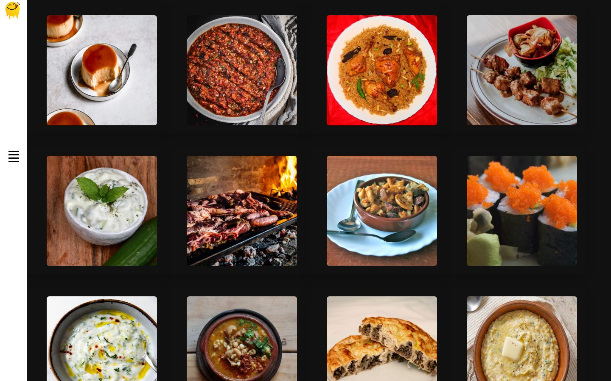
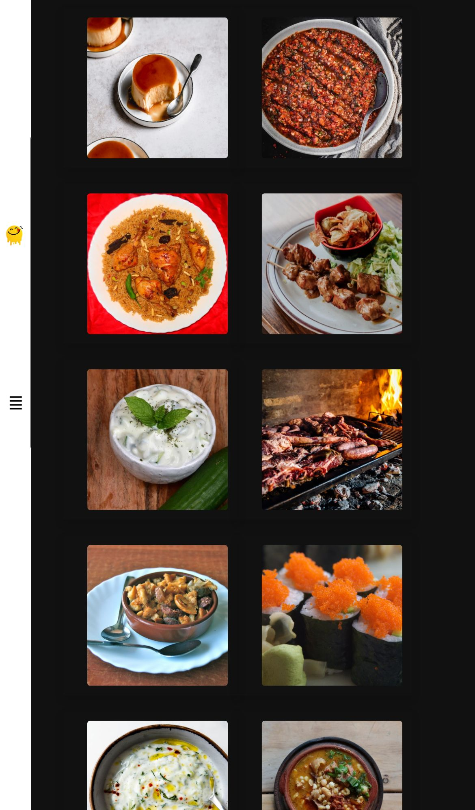

<div align="center">

# JS Exam: Meal Browser

### A recipe browser built on TheMealDB API with vanilla JavaScript and jQuery

My JavaScript exam project from my 2022 front-end training. It loads meals, categories, areas and ingredients from the free [TheMealDB](https://www.themealdb.com/api.php) API and renders them as a responsive card grid behind a slide-out side menu.

[](https://developer.mozilla.org/docs/Web/HTML)
[](https://developer.mozilla.org/docs/Web/CSS)
[](https://developer.mozilla.org/docs/Web/JavaScript)
[](https://jquery.com)
[](https://getbootstrap.com)
[](https://fontawesome.com)
<br>
[](https://eslamraafat1.github.io/JS-Exam/task/)

**[Live demo](https://eslamraafat1.github.io/JS-Exam/task/)** ·
**[Portfolio](https://new-portfolio-ashy-xi.vercel.app/)** ·
**[LinkedIn](https://www.linkedin.com/in/eslamraafat-dev/)** ·
**[Email](mailto:eslamraafat736@gmail.com)**

<br>



</div>

<table>
  <tr>
    <td width="40%"></td>
    <td width="60%">
      <b>What you see</b><br>
      Meal thumbnails fetched live from TheMealDB on page load. The hamburger button on the left slides the menu in (Search, Categories, Area, Ingredients, Contact Us).
    </td>
  </tr>
  <tr>
    <td align="center"><sub>Mobile (iPhone 13)</sub></td>
    <td align="center"><sub>Desktop 1440 × 900</sub></td>
  </tr>
</table>

---

## Overview

This is a **learning project**: the final JavaScript exam of my 2022 front-end course. The goal was to practise working with a real REST API from the browser: `fetch` with `async/await`, turning JSON into DOM with template literals, and wiring UI events with jQuery.

The demo lives in the `task/` folder, so the live link is `/JS-Exam/task/`.

## Features

**Data from TheMealDB**

- On load, fetches `search.php?s=` and renders every returned meal as a card (thumbnail, and on hover a layer with the name and instructions).
- **Categories:** `categories.php`, shown as cards with the category image and name.
- **Area:** `list.php?a=list`, one card per cuisine area.
- **Ingredients:** `list.php?i=list`, with the first 20 words of each description.

**UI**

- Slide-out side menu animated with jQuery `.animate()`, opened and closed by the hamburger and close buttons.
- **Contact Us** view rendered from JavaScript, with regex validators for name, email, phone, age, password and password confirmation.
- Bootstrap 5 grid (`col-md-6 col-lg-3`) and a Bootstrap modal.

### Known limitations

Kept as written for the exam:

- The Search view shows its two inputs, but they are not connected to a search request yet.
- The contact form's validators look up the inputs before the form is rendered, so the error messages don't show.
- Clicking a card opens a modal with placeholder content, not the meal's own recipe.
- The page has no `<meta name="viewport">`, so phones render the desktop layout scaled down.

## Tech stack

| Layer | Tools |
| --- | --- |
| Markup and styles | HTML5, CSS3, Bootstrap 5.2 (local copy) |
| Scripting | Vanilla JavaScript (`fetch`, `async/await`, template literals), jQuery 3.6.1 |
| Icons | Font Awesome Free 6.1.2 (local copy) |
| Data | [TheMealDB](https://www.themealdb.com/api.php) public API (test key `1`) |
| Hosting | GitHub Pages |

## Project structure

```text
.
├── task/                    # the exam app (served at /JS-Exam/task/)
│   ├── index.html           # side menu, card grid, modal
│   ├── style.js             # API calls, rendering, menu animation, form validation
│   ├── style.css
│   ├── bootstrap.min.css · bootstrap.bundle.min.js · jquery-3.6.1.min.js
│   ├── font/ · webfonts/    # Font Awesome
│   └── image/               # logo
├── img/                     # extra images (not used by task/)
├── beef.png · chicken.png   # images referenced by the modal
└── docs/screenshots/        # README images
```

## Getting started

No build step. Serve the repo root so the `../beef.png` paths resolve, then open `/task/`:

```bash
git clone https://github.com/Eslamraafat1/JS-Exam.git
cd JS-Exam
npx serve .          # then open http://localhost:3000/task/
```

You need an internet connection, because the meal data comes from TheMealDB.

## Deployment

Hosted on **GitHub Pages** from the default branch. The repo root has no `index.html`, so the app is at **https://eslamraafat1.github.io/JS-Exam/task/**.

## Author

**Eslam Raafat**, Front-End Developer (React · Next.js · TypeScript)

- **Portfolio:** [new-portfolio-ashy-xi.vercel.app](https://new-portfolio-ashy-xi.vercel.app/)
- **LinkedIn:** [linkedin.com/in/eslamraafat-dev](https://www.linkedin.com/in/eslamraafat-dev/)
- **GitHub:** [@Eslamraafat1](https://github.com/Eslamraafat1)
- **Email:** [eslamraafat736@gmail.com](mailto:eslamraafat736@gmail.com)
